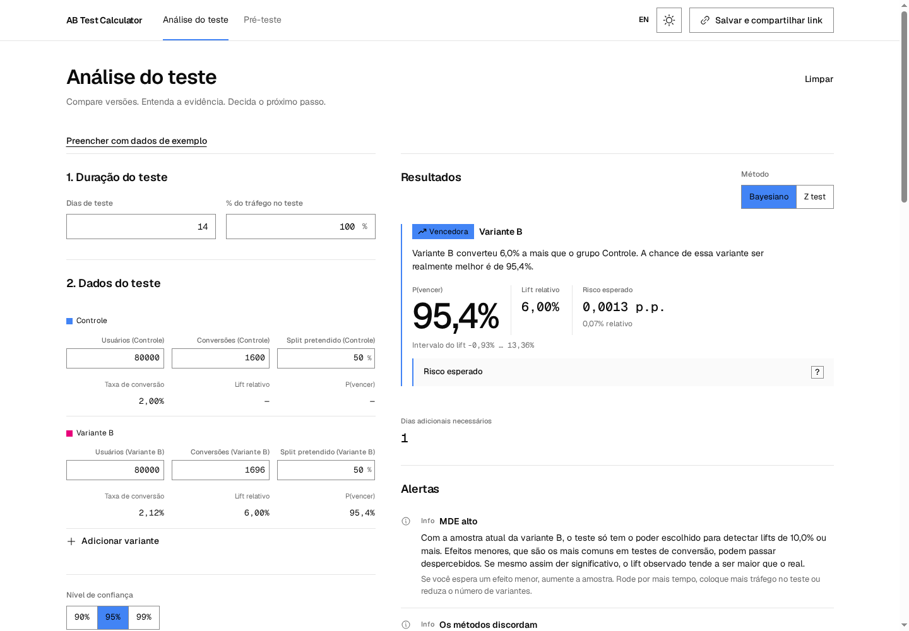
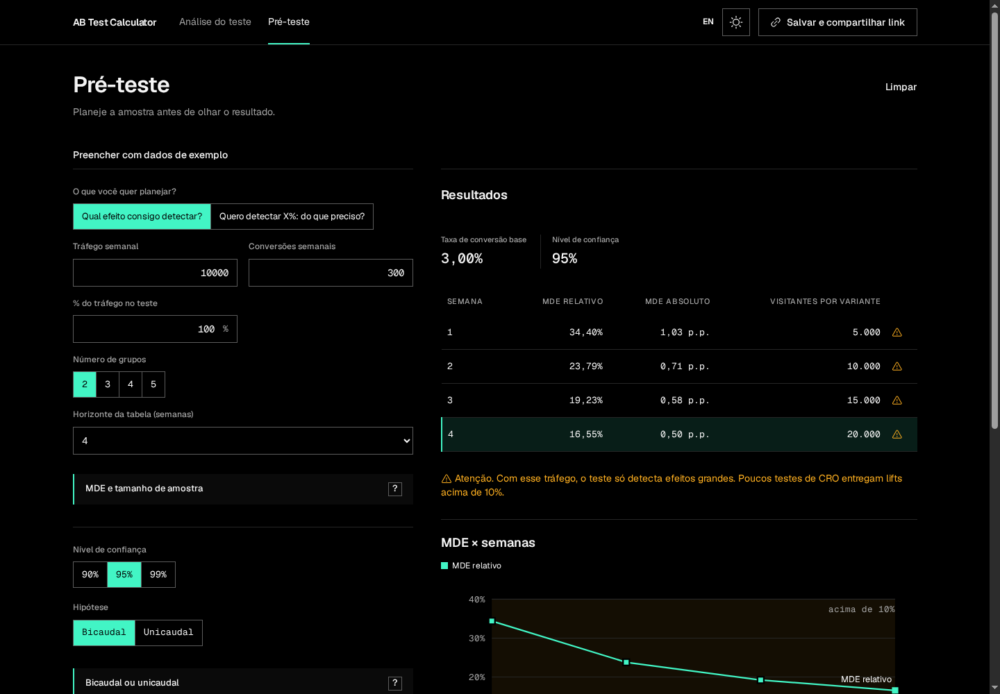
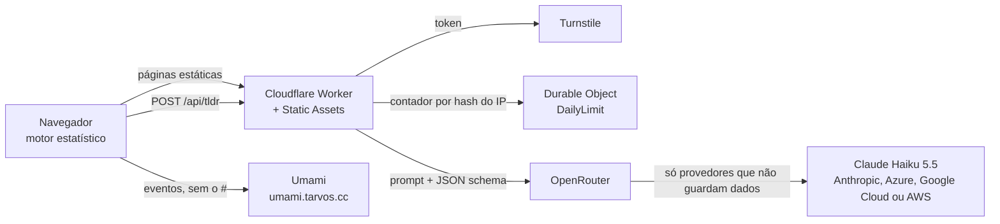

# AB Test Calculator

Calculadora gratuita e anônima para planejar e analisar testes A/B. Está no ar em [ab-test.iago.wtf](https://ab-test.iago.wtf), em português e inglês.

Toda a estatística roda no seu navegador. Os números do teste ficam na URL, depois do `#`, e não vão para nenhum servidor. A única chamada de rede com dados do teste é o TL;DR por IA, e só quando você clica no botão.



## O que a calculadora faz

São duas abas que compartilham as mesmas configurações (confiança, poder, hipótese, Bonferroni e moeda). Mudar a confiança numa aba muda na outra.

| Recurso | O que entrega |
|---|---|
| Pré-teste | Dois modos inversos. "Qual efeito consigo detectar?" mostra o MDE semana a semana. "Quero detectar X%" mostra a amostra por variante e a duração em dias |
| Teste sequencial | Plano de 2 a 12 espiadas com fronteiras O'Brien-Fleming (gasto de alfa de Lan-DeMets). Na análise, diz se a espiada atual cruzou a fronteira |
| Análise Bayesiana | Padrão. Prior Beta(1, 1), probabilidade de vencer o controle, probabilidade de ser a melhor, risco esperado e intervalo de credibilidade do lift |
| Z test | Teste de duas proporções com erro padrão não agrupado, uni ou bicaudal, com correção de Bonferroni a partir de 3 grupos |
| A/B/n | Controle e até 4 variantes |
| Veredito | Quatro estados. Vencedora, perdedora, inconclusiva sem diferença relevante e inconclusiva sem poder |
| Alertas | 11 checagens por regra, entre elas SRM (qui-quadrado, p < 0,01), poucos dados, menos de 7 dias, semanas incompletas, mais de 8 semanas e possível peeking |
| Receita | Transações extras por mês, contribuição mensal e projeção em 3, 6 ou 12 meses |
| Gráficos | Curva MDE x semanas, distribuições das CRs, distribuição do lift, intervalos do lift e projeção de receita. Cada gráfico tem uma tabela equivalente |
| TL;DR por IA | Um resumo de 2 a 4 frases e a explicação de cada alerta. A IA não calcula nada |
| Link compartilhável | Um link com todo o estado, inclusive o TL;DR. Quem abre vê a mesma tela sem gastar IA |
| Explicações | Cada conceito tem um "?" que abre duas camadas de texto, uma sem fórmula e uma técnica, com os números do seu teste |

A página [Sobre e metodologia](https://ab-test.iago.wtf/pt/sobre) lista todas as fórmulas e referências.



## Por que confiar nos números

**Uma referência independente.** O script `scripts/reference/generate.py` recalcula os cenários de teste em Python, só com a biblioteca padrão, sem compartilhar código com `src/stats/`. Ele calcula as posteriores Beta por quadratura, não por simulação. `npm run reference` grava o resultado em `src/stats/__fixtures__/reference.json`, e os testes do motor comparam cada número com esse arquivo. Um erro de fórmula de qualquer um dos lados aparece como divergência.

| Grandeza | Tolerância nos testes |
|---|---|
| Valores determinísticos (amostra, MDE, z, p-value) | Erro relativo de 1e-7 |
| Fronteiras sequenciais e fator de inflação da amostra | Erro relativo de 1e-5 |
| Valores de Monte Carlo (P(vencer), risco esperado) | 4 erros padrão da simulação |
| Fronteiras O'Brien-Fleming publicadas pelo gsDesign e pelo ldbounds | 5e-4 |

**A mesma entrada dá sempre o mesmo número.** O Bayesiano usa 50.000 amostras de Monte Carlo por grupo. O gerador pseudoaleatório recebe uma semente derivada do hash dos inputs, então os mesmos números produzem sempre a mesma P(vencer). Um link compartilhado mostra exatamente o que o autor viu. Uma diferença entre duas execuções é um bug, não ruído.

**Testado contra o JIT.** O Node 24 tem um bug no Maglev do V8 (`nodejs/node#66457`) que já deu números diferentes para a mesma entrada. `src/stats/jit.test.ts` sobe 48 motores frios e compara cada resultado com o do interpretador. Por isso o projeto exige Node 26.12 ou superior.

**Fórmulas iguais às de mercado.** O Z test segue o ABTestGuide, então quem compara as duas ferramentas encontra os mesmos números.

## Privacidade

| Dado | Para onde vai |
|---|---|
| Números que você digita | Ficam no navegador. O cálculo não faz nenhuma chamada de rede |
| Estado da tela | Fica no fragmento `#s=...` da URL e num rascunho no `localStorage`. O navegador nunca envia o fragmento ao servidor |
| Pedido de TL;DR | Vai para o Worker `/api/tldr` e dele para a OpenRouter. Detalhes abaixo |
| Uso do site | Pageviews e eventos anônimos vão para o Umami do dono (`umami.tarvos.cc`), sem cookie, sem o fragmento e sem a query string |

O TL;DR só roda quando você clica em **Gerar TL;DR**. O navegador envia ao Worker os números já calculados, as configurações, os alertas das regras, os nomes dos grupos (cortados em 40 caracteres) e um token do Turnstile. Nenhum outro texto seu sai do navegador.

O Worker faz quatro coisas com esse pedido:

1. Valida o token do Turnstile com a Cloudflare.
2. Conta o pedido num Durable Object identificado pelo hash do IP. O objeto guarda só o contador.
3. Envia o prompt à OpenRouter, que o encaminha ao Claude Haiku 5.5 (`anthropic/claude-haiku-5.5`). A OpenRouter pode servir esse modelo pela Anthropic, pela Microsoft Azure, pelo Google Cloud ou pela AWS. O Worker só aceita provedores que não guardam dados (`provider.data_collection: "deny"`).
4. Valida a resposta contra um JSON schema estrito e devolve ao navegador.

Nada é gravado, logado ou cacheado com os dados do teste. Os eventos do Umami carregam só o tipo de ação (método escolhido, idioma, tema e similares), nunca números do teste nem nomes de grupos. O script do Umami tem `data-exclude-hash` e `data-exclude-search` e só registra visitas em `ab-test.iago.wtf`.

## Arquitetura

O produto é um site estático com um único endpoint dinâmico.



| Regra do `/api/tldr` | Valor |
|---|---|
| Limite diário | 20 por IP (`vars.DAILY_TLDR_LIMIT`) |
| Limite de rajada | 5 por minuto (binding `BURST_LIMIT`) |
| Timeout | 20 s |
| Severidade | Só as regras marcam um alerta como crítico. Um achado da IA vai no máximo até "atenção" |
| Falha | A página mostra os alertas das regras com o texto padrão e o aviso "TL;DR indisponível" |
| Custo | Uma chamada real pequena (256 tokens de entrada, 76 de saída) custou US$ 0,0000636. Um TL;DR completo custa cerca de US$ 0,0004, por estimativa |

## Stack

| Camada | Ferramenta |
|---|---|
| Site | Astro 6 com saída estática, uma página por idioma e aba |
| Interface | Ilhas Preact 10 e Tailwind 4 |
| Gráficos | SVG próprio, sem biblioteca |
| Hospedagem | Cloudflare Workers com Static Assets |
| Limites | Durable Objects e o binding de Rate Limiting |
| Anti-bot | Cloudflare Turnstile |
| IA | Claude Haiku 5.5 via OpenRouter (`anthropic/claude-haiku-5.5`) |
| Analytics | Umami |
| Testes | Vitest 5 e o gerador de referência em Python |
| Runtime de desenvolvimento | Node 26.12 ou superior (`.nvmrc`) |

## Estrutura do repositório

```
src/stats/       motor estatístico puro (pré-teste, Z test, Bayesiano, sequencial, SRM, alertas, receita)
src/app/         estado, codec do link #s=, Web Worker do motor, cliente do TL;DR, analytics
src/components/  ilhas Preact da calculadora, dos gráficos, dos alertas, do TL;DR e das explicações
src/pages/       rotas /pt e /en e a página 404
src/i18n/        textos em PT e EN, slugs das rotas, página de metodologia
src/shared/      contrato do /api/tldr, usado pelo navegador e pelo Worker
worker/          redirect da raiz, /api/tldr, limites, prompt, validação da resposta
scripts/         deploy, orçamento de JS, gerador de referência, benchmark do motor, Lighthouse, roteiros e capturas da UI
.claude/skills/verify-ab-test-calculator/   harness que sobe o app e o dirige num navegador
```

## Rodar localmente

Use Node 26.12 ou superior. Com `nvm`, rode `nvm use` na raiz.

```bash
npm install
npm run dev
```

`npm run dev` sobe só o Astro em `localhost:4321`, sem o Worker. A calculadora funciona inteira. O botão de TL;DR não tem para onde enviar o pedido.

| Comando | O que faz |
|---|---|
| `npm test` | Roda os testes do motor, do Worker, do estado e dos textos |
| `npm run typecheck` | Roda `astro check` e o `tsc` do Worker |
| `npm run build` | Gera o site estático em `dist/` |
| `npm run budget` | Depois do build, mede o JS de cada página. Falha acima de 150 KB gzip |
| `npm run reference` | Regenera `src/stats/__fixtures__/reference.json` a partir do Python |
| `npm run preview` | Faz o build e serve site e Worker com `wrangler dev` |

Se você mudar uma fórmula, mude também o gerador em Python e rode `npm run reference`. Os dois lados precisam concordar.

## Verificar no navegador

A skill `.claude/skills/verify-ab-test-calculator` sobe o site e o Worker juntos e dirige o app num Chromium headless, com capturas, snapshots ARIA e log de rede. Use depois de qualquer mudança nas telas, no motor, no Worker, no link compartilhado, nos idiomas ou no tema.

```bash
export OPENROUTER_API_KEY=...   # opcional; sem a chave, o TL;DR cai no fallback por regras
eval "$(.claude/skills/verify-ab-test-calculator/scripts/ctl launch)"
.claude/skills/verify-ab-test-calculator/scripts/ctl doctor
.claude/skills/verify-ab-test-calculator/scripts/ctl browser start
.claude/skills/verify-ab-test-calculator/scripts/ctl browser goto /pt/analise
.claude/skills/verify-ab-test-calculator/scripts/ctl cleanup
```

O TL;DR só funciona localmente se `OPENROUTER_API_KEY` estiver exportada antes do `ctl launch`. O build de verificação usa as chaves de teste do Turnstile e desliga o Umami. As jornadas de cada recurso estão em `.claude/skills/verify-ab-test-calculator/features/`, e as evidências ficam em `artifacts/verify/<run-id>/`, fora do Git.

## Deploy

O Worker precisa de dois secrets. Configure cada um uma vez:

```bash
npx wrangler secret put OPENROUTER_API_KEY
npx wrangler secret put TURNSTILE_SECRET_KEY
```

Os valores públicos do build ficam em `.env.production`. São a site key do Turnstile e o endereço, o website id e o domínio do Umami. Nenhum deles é secreto.

```bash
npm run deploy
```

`scripts/deploy.sh` roda os testes, o build, o orçamento de JS e `wrangler deploy`, nessa ordem, e para no primeiro erro. Se `CLOUDFLARE_API_TOKEN` não estiver definida, o script usa a sessão OAuth do CLI `cf`. O Worker atende no domínio `ab-test.iago.wtf`, configurado em `wrangler.jsonc`.

## Trocar o modelo de IA

O nome do modelo existe num único lugar, `vars.AI_MODEL` em `wrangler.jsonc`.

1. Troque o valor por outro id de modelo da OpenRouter.
2. Rode `npm run deploy`.

O modelo novo precisa aceitar JSON schema estrito e ter provedores que não guardam dados. Sem isso, a chamada falha e a página mostra o fallback. Alterar a variável no painel da Cloudflare também funciona, mas o próximo deploy volta ao valor do `wrangler.jsonc`.

## Onde ficam as decisões

| Arquivo | Conteúdo |
|---|---|
| [PRD.md](PRD.md) | Fonte de verdade do produto. Fórmulas, regras em tabela, edge cases, pontos a definir e decisões registradas com data |
| [ROUTES.md](ROUTES.md) | Telas, slugs por idioma, estados de cada tela e o endpoint `/api/tldr` |
| [DESIGN.md](DESIGN.md) | Design system "Swiss Neon". Tokens, paleta dos gráficos, patterns de componente e o que evitar |
| [AGENTS.md](AGENTS.md) | Regras para agentes de código, inclusive as três restrições invioláveis |
| [feedback.md](feedback.md) | Correções do dono que valem como regra |
| `.audit/` | Registro das decisões de cada rodada de trabalho (`calculator-v1.tsv`) e relatórios de verificação |

Quando o código e o DESIGN.md divergem, o código vence e o documento é atualizado no mesmo PR. Uma decisão de produto nova entra no PRD.md com nota datada.

## Licença

O repositório ainda não define uma licença.
